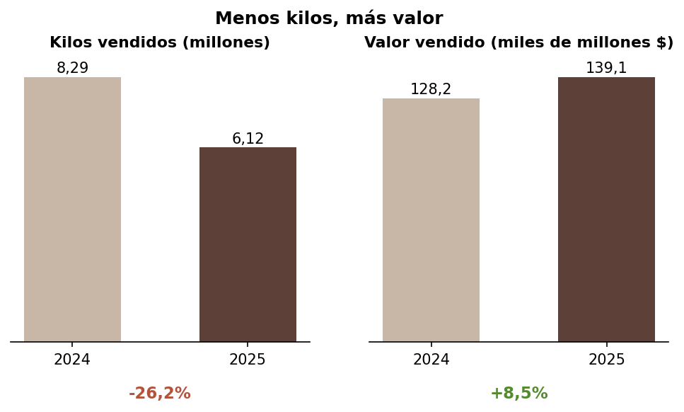
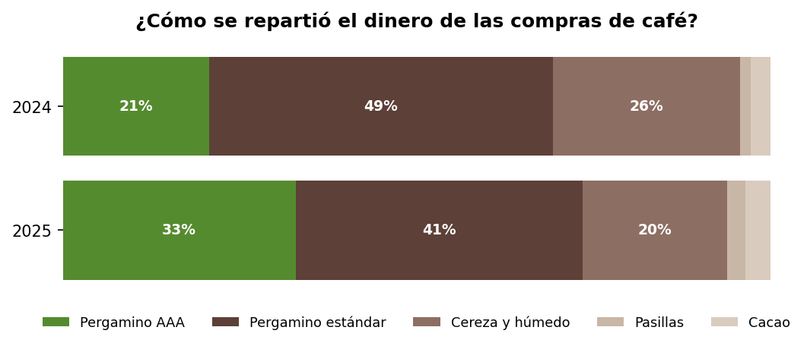

# Menos café, más valor: Cooperativa de Caficultores de Anserma 2025

Análisis de los resultados de 2025 frente a 2024 de la Cooperativa de Caficultores de Anserma (Caldas), construido a partir de sus informes públicos: estados financieros certificados y acta de la LXIV Asamblea General de Delegados.

## La historia en cuatro cifras

| Indicador | Resultado |
|---|---|
| Kilos de café comprados | **-34%** (de 8,3 a 5,4 millones) |
| Valor de las ventas de café | **+8,5%** (de $128.206 a $139.137 millones) |
| Participación del café AAA en las compras | **de 21% a 33%** |
| Efectivo al cierre del año | **+57%** (de $3.608 a $5.661 millones) |

En 2025 el clima afectó la floración y la cosecha cayó con fuerza. Aun así, la cooperativa vendió más en valor gracias a mejores precios, al crecimiento del café AAA (el único que aumentó en kilos) y a un cambio en su mezcla de ventas: el café excelso pasó del 45% al 63% del valor vendido.



## Preguntas que responde el análisis

1. ¿Qué cafés se compraron menos y cuáles resistieron la caída de la cosecha?
2. ¿Cómo cambió el precio por kilo de cada calidad?
3. ¿Qué vendió la cooperativa y cómo cambió su mezcla de productos?
4. ¿Cómo se comparan las cinco sucursales en asociados, café, fertilizante y cartera?
5. ¿Cómo quedó la salud financiera: liquidez, endeudamiento y caja?
6. ¿Qué recursos llegaron directamente a los caficultores?
7. ¿Cuál es el principal reto financiero de los próximos años?

## Hallazgos principales

- **El café AAA fue el único que creció** (+13% en kilos) y ya recibe uno de cada tres pesos de las compras.
- **El precio por kilo subió entre 31% y 56%** en todas las calidades de café; las pasillas casi lo duplicaron.
- **La cooperativa vendió un producto más terminado:** el excelso se mantuvo en kilos mientras el pergamino cayó 57%.
- **Más líquida y menos endeudada:** la deuda bancaria bajó de $4.240 a $58 millones y la razón corriente, sin el café en depósito de los asociados, subió de 1,48 a 1,70.
- **Risaralda y Viterbo** tienen una cartera vencida de 6,2%, frente a un promedio de 3,3%.
- **El reto:** la cuota anual del acuerdo con la Federación Nacional de Cafeteros ($1.204 millones) equivale al 94% del excedente operacional de 2025.



## Estructura del repositorio

```
├── README.md
├── datos/                     # 13 tablas transcritas de los PDF
│   └── resultados/            # Indicadores calculados por el script
├── scripts/
│   └── analisis.py            # Cálculos y gráficas
├── graficos/                  # 10 gráficas en PNG
└── informe/                   # Informe final
```

## Datos

| Archivo | Contenido | Fuente |
|---|---|---|
| `compras_cafe_por_producto.csv` | Kilos y valor comprado por calidad, 2024 y 2025 | Informe de gestión |
| `ventas_cafe_por_producto.csv` | Kilos y valor vendido por producto, 2024 y 2025 | Informe de gestión |
| `fertilizante_por_sucursal.csv` | Sacos y valor vendido por sucursal | Informe de gestión |
| `creditos_colocados_2025.csv` | Créditos otorgados por sucursal | Informe de gestión |
| `cartera_por_sucursal_dic2025.csv` | Cartera vigente y vencida por sucursal | Informe de gestión |
| `asociados_y_delegados.csv` | Asociados hábiles y delegados por zona | Informe Junta de Vigilancia |
| `incentivo_125_kilo_2025.csv` | Incentivo por kilo vendido, por sucursal | Informe de gestión |
| `programa_faia_2025.csv` | Beneficiarios del programa FAIA | Informe de gestión |
| `planta_beneficio_cps.csv` | Café procesado en la planta de beneficio | Informe de gestión |
| `programas_sociales_2025.csv` | Recursos de los principales programas | Informe de gestión y ejecución Fairtrade |
| `estado_situacion_financiera.csv` | Balance 2024 y 2025 | Estados financieros |
| `resultados_seleccionados.csv` | Líneas del estado de resultados | Estados financieros |
| `flujo_efectivo_resumen.csv` | Flujo de efectivo por actividad | Estados financieros |

Los documentos fuente son PDF escaneados, así que cada tabla se transcribió a mano y se validó contra los totales publicados antes de usarla. Las cifras están en pesos colombianos corrientes.

## Cómo reproducirlo

```bash
pip install pandas matplotlib
python scripts/analisis.py
```

El script lee los CSV, guarda los indicadores en `datos/resultados/` y genera las gráficas en `graficos/`.

## Notas metodológicas

- Los kilos comprados (pergamino seco) y vendidos (en parte excelso) no se comparan directamente, porque la trilla reduce cerca del 20% del peso.
- Los kilos vendidos por sucursal se estimaron dividiendo el incentivo de $125 por kilo entre 125.
- Los indicadores de liquidez y endeudamiento se presentan también sin el café en depósito, que pertenece a los asociados y figura por igual en el activo y el pasivo.
- Las cifras de los programas sociales no se suman porque algunos se financian con las mismas primas.

## Fuentes

Documentos publicados por la Cooperativa de Caficultores de Anserma en [cooperativaanserma.com.co](https://www.cooperativaanserma.com.co):

- Estados financieros a 31 de diciembre de 2025 y 2024.
- Acta de la LXIV Asamblea General Ordinaria de Delegados (24 de marzo de 2026).

## Autor

**Anderson Mateo Iglesias Suarez**, analista de datos
smateoiglesias@gmail.com · 320 891 4235

Proyecto personal con fines de portafolio, elaborado con información pública. No tiene relación oficial con la cooperativa.
